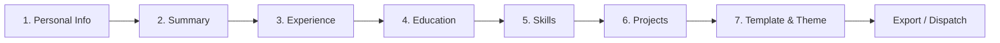

# 📱 Resume Genie — Backend & Environment Architecture

[](https://spring.io/projects/spring-boot)
[](https://www.oracle.com/java/)
[](https://www.mongodb.com/)
[](https://junit.org/)
[](#)

Production-grade Spring Boot 3.x backend for **Resume Genie**, an AI-assisted resume building mobile application designed for React Native + Expo (Android & Web) by **sky.devX**.

---

## 📑 Table of Contents

1. [Prerequisites](#1-prerequisites)
2. [Java & Maven Setup](#2-java--maven-setup)
3. [Local Environment Configuration](#3-local-environment-configuration)
4. [MongoDB Database Configuration](#4-mongodb-database-configuration)
5. [How to Start the Backend in Development Mode](#5-how-to-start-the-backend-in-development-mode)
6. [How to Connect the Expo Browser App](#6-how-to-connect-the-expo-browser-app)
7. [How to Connect an Android Emulator or Physical Phone](#7-how-to-connect-an-android-emulator-or-physical-phone)
8. [How to Build and Test the Project](#8-how-to-build-and-test-the-project)
9. [How to Deploy to Render](#9-how-to-deploy-to-render)
10. [How to Configure Production Variables](#10-how-to-configure-production-variables)
11. [How to Troubleshoot Common Errors](#11-how-to-troubleshoot-common-errors)
12. [How to Switch Safely Between Development & Production](#12-how-to-switch-safely-between-development--production)
13. [Architecture & 7-Step Stepper Workflow](#13-architecture--7-step-stepper-workflow)
14. [Documentation References](#14-documentation-references)

---

## 1. Prerequisites

Before running the application, ensure the following are installed:
- **Java Development Kit (JDK 21 LTS)** (Java 17 LTS also supported)
- **Git**
- **MongoDB** (Local instance or free cloud cluster on MongoDB Atlas)
- **Node.js 18+ & npm/pnpm** (for the frontend React Native / Expo application)
- **Third-party test accounts** (optional for local mock testing, required for live features):
  - [Brevo](https://www.brevo.com/) for transactional email dispatch
  - [Cloudinary](https://cloudinary.com/) for cloud image storage
  - [Razorpay](https://razorpay.com/) for payment gateway integration

---

## 2. Java & Maven Setup

Verify your Java runtime:
```bash
java -version
```
Ensure `JAVA_HOME` points to your JDK 21 (or JDK 17/25) installation.

The project bundles the Maven Wrapper (`mvnw` on Linux/macOS, `mvnw.cmd` on Windows), so you do not need Maven pre-installed. Test the wrapper:
```bash
# In ResumeBuilderApp-Backend directory:
./mvnw -v          # Linux / macOS
.\mvnw.cmd -v      # Windows PowerShell
```

---

## 3. Local Environment Configuration

1. Copy the template file to `.env`:
   ```bash
   cp .env.example .env
   ```
2. Open `.env` and fill in your local secrets. For immediate local testing without email verification, set `EMAIL_VERIFICATION_REQUIRED=false`:
   ```dotenv
   SPRING_PROFILES_ACTIVE=dev
   PORT=8080
   MONGODB_URI=mongodb://localhost:27017/resumegenie
   MONGODB_DATABASE=resumegenie
   JWT_SECRET=devDefaultSecretKeyForResumeGenieMustBeAtLeast32BytesLongLocalDevOnly!
   APP_BASE_URL=http://localhost:8081
   BACKEND_BASE_URL=http://localhost:8080
   CORS_ALLOWED_ORIGINS=http://localhost:8081,http://localhost:19006,http://localhost:3000,http://localhost:5173
   EMAIL_VERIFICATION_REQUIRED=false
   ```
3. Never commit `.env` or credentials into version control. Both `.env` and `*.local` are included in `.gitignore`.

---

## 4. MongoDB Database Configuration

The application explicitly connects to the database named **`resumegenie`** (never mutating or overriding legacy databases such as `resumebuilder`).

### Option A: Local MongoDB
Ensure your local MongoDB daemon is running on port 27017:
```bash
mongosh "mongodb://localhost:27017/resumegenie"
```

### Option B: MongoDB Atlas
Create a free M0 cluster on MongoDB Atlas:
1. Under **Database Access**, create a user with read/write privileges.
2. Under **Network Access**, whitelist your IP address.
3. Configure `MONGODB_URI` in `.env`:
   ```dotenv
   MONGODB_URI=mongodb+srv://<username>:<password>@cluster0.mongodb.net/resumegenie?retryWrites=true&w=majority
   ```

---

## 5. How to Start the Backend in Development Mode

Navigate to the `ResumeBuilderApp-Backend` directory and launch Spring Boot with the `dev` profile:

**Linux / macOS:**
```bash
./mvnw spring-boot:run -Dspring-boot.run.profiles=dev
```

**Windows PowerShell:**
```powershell
.\mvnw.cmd spring-boot:run -Dspring-boot.run.profiles=dev
```

**Verify backend status:**
- Health endpoint: [http://localhost:8080/api/health](http://localhost:8080/api/health)
- Swagger / OpenAPI UI: [http://localhost:8080/swagger-ui.html](http://localhost:8080/swagger-ui.html)
- Actuator: [http://localhost:8080/actuator/health](http://localhost:8080/actuator/health)

---

## 6. How to Connect the Expo Browser App

When developing the React Native app for Web (`npx expo start --web`), Expo runs on `http://localhost:8081` or `http://localhost:19006`.

1. In your Expo project root, configure `.env.development`:
   ```dotenv
   EXPO_PUBLIC_API_URL=http://localhost:8080
   ```
2. The backend development profile is configured with CORS to accept origins `http://localhost:8081` and `http://localhost:19006`.
3. Open your browser to the Expo app URL; requests will reach `http://localhost:8080/api/...` with credentials and JWT Bearer headers supported.

---

## 7. How to Connect an Android Emulator or Physical Phone

### Android Emulator
Android Emulators cannot connect to `localhost` to reach your host computer because `localhost` refers to the emulator's internal loopback.
- Use the Android emulator host gateway IP: **`10.0.2.2`**
- Set in Expo frontend configuration:
  ```dotenv
  EXPO_PUBLIC_API_URL=http://10.0.2.2:8080
  ```

### Physical Android Device
1. Connect your computer and your phone to the **same Wi-Fi network**.
2. Find your PC's LAN IP address:
   - Windows: `ipconfig` (look for `IPv4 Address`, e.g. `192.168.1.50`)
   - Mac/Linux: `ifconfig` (look for `inet`, e.g. `192.168.1.50`)
3. Set in Expo frontend configuration:
   ```dotenv
   EXPO_PUBLIC_API_URL=http://192.168.1.50:8080
   ```
4. Update `CORS_ALLOWED_ORIGINS` in your backend `.env` file to include your computer's IP:
   ```dotenv
   CORS_ALLOWED_ORIGINS=http://localhost:8081,http://192.168.1.50:8081
   ```
5. Ensure Windows Firewall permits incoming TCP traffic on port 8080 for private networks.

---

## 8. How to Build and Test the Project

### Running the Test Suite
The backend contains 32 unit and integration tests covering Authentication, JWT issuance, Resume CRUD, Step/Section updates, Free/Plus Plan entitlements, Razorpay signature verification, Webhook idempotency, Cloudinary uploads, and Production environment checks.

```bash
# In ResumeBuilderApp-Backend directory:
.\mvnw.cmd test
```

### Packaging for Production
```bash
.\mvnw.cmd package
```
Generates the production executable fat JAR:
`ResumeBuilderApp-Backend/target/resume-genie-backend.jar`

---

## 9. How to Deploy to Render

Render hosts the Spring Boot backend as a Web Service.

### Build & Run Settings
- **Service Type:** Web Service
- **Root Directory:** `ResumeBuilderApp-Backend`
- **Environment:** `Java` (or `Docker`)
- **Build Command:**
  ```bash
  ./mvnw clean package -DskipTests=false
  ```
- **Start Command:**
  ```bash
  java -jar target/resume-genie-backend.jar --spring.profiles.active=prod
  ```
- **Health Check Path:** `/api/health`

---

## 10. How to Configure Production Variables

In Render Dashboard -> **Environment**, configure the required secrets:

```dotenv
SPRING_PROFILES_ACTIVE=prod
MONGODB_URI=mongodb+srv://<username>:<password>@cluster0.mongodb.net/resumegenie?retryWrites=true&w=majority
MONGODB_DATABASE=resumegenie
JWT_SECRET=replace_with_a_secure_random_base64_or_hex_string_min_32_bytes
APP_BASE_URL=https://resumegenie.skydevx.com
BACKEND_BASE_URL=https://resume-genie-backend.onrender.com
CORS_ALLOWED_ORIGINS=https://resumegenie.skydevx.com
SPRING_MAIL_HOST=smtp-relay.brevo.com
SPRING_MAIL_PORT=587
SPRING_MAIL_USERNAME=your_brevo_smtp_login
SPRING_MAIL_PASSWORD=your_brevo_smtp_key
SPRING_MAIL_FROM=support@skydevx.com
CLOUDINARY_CLOUD_NAME=your_cloudinary_name
CLOUDINARY_API_KEY=your_cloudinary_key
CLOUDINARY_API_SECRET=your_cloudinary_secret
RAZORPAY_KEY_ID=rzp_live_yourKeyId
RAZORPAY_KEY_SECRET=yourLiveSecret
RAZORPAY_WEBHOOK_SECRET=yourWebhookSecret
EMAIL_VERIFICATION_REQUIRED=true
```

> [!CAUTION]
> The application includes a `ProductionEnvironmentValidator`. If any mandatory variable (`MONGODB_URI`, `JWT_SECRET`, `CORS_ALLOWED_ORIGINS`, `RAZORPAY_KEY_ID`, `RAZORPAY_KEY_SECRET`) is missing or invalid in `prod` mode, startup will fail immediately, preventing deployment in an insecure or broken state.

---

## 11. How to Troubleshoot Common Errors

| Issue | Cause | Solution |
| :--- | :--- | :--- |
| `Network Error` from Android Phone | Phone trying to access `localhost:8080` | Use your computer's local Wi-Fi IP (e.g. `http://192.168.1.X:8080`). Whitelist port 8080 in Windows Firewall. |
| `Network Error` from Android Emulator | Emulator trying to access `localhost:8080` | Use `http://10.0.2.2:8080`. |
| `CORS Error: Missing Allow Origin Header` | Frontend domain not in CORS whitelist | Add your frontend origin (e.g. `http://localhost:8081`) to `CORS_ALLOWED_ORIGINS`. |
| `Production startup failed: MONGODB_URI missing` | Missing production environment variables | In `prod` profile, all mandatory secrets must be set in environment variables. |
| `JWT signature verification failed` | Secret changed or token corrupted | Clear client storage and log in again to receive a fresh token signed with the current `JWT_SECRET`. |
| `PlanLimitExceededException` | Free user exceeded 3 resumes or picked premium template | Upgrade the user to `PLUS` via Razorpay payment flow or update the user document in MongoDB. |

---

## 12. How to Switch Safely Between Development & Production

To switch profiles locally or during deployment:

### Local Development
```bash
./mvnw spring-boot:run -Dspring-boot.run.profiles=dev
```
- Safe dev defaults
- Detailed diagnostic logging with sensitive credentials redacted
- Local origins accepted

### Production Staging / Live Run
```bash
java -jar target/resume-genie-backend.jar --spring.profiles.active=prod
```
- Strict production checks
- Zero wildcard CORS with credentials
- Internal stack traces stripped from public API error responses
- Mandatory server-side cryptographic signature validation for all payments

---

## 13. Architecture & 7-Step Stepper Workflow

Resume Genie structures resume creation around a 7-step mobile stepper workflow:



The backend supports full resume updates (`PUT /api/resumes/{id}`) as well as incremental single-section updates (`PATCH /api/resumes/{id}/section`), enabling instant autosaving on mobile devices after each step.

---

## 14. Documentation References

- 📘 [Local Development Guide](docs/LOCAL_DEVELOPMENT.md)
- 🚀 [Production Deployment Guide (Render)](docs/PRODUCTION_DEPLOYMENT.md)
- 📡 [Complete REST API Reference](docs/API_REFERENCE.md)
- 🔐 [Environment Variables Guide](docs/ENVIRONMENT_VARIABLES.md)
